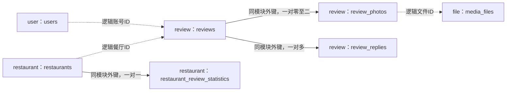

# 评价模块已执行结构与迁移

核对日期：2026-10-30。V4建立5张表，V5新增计分人数、作者历史索引并重建统计，V6调整上传状态，V7支持五图；本地开发库已升级至V7。发布及事务计分、OSS上传/绑定/访问/清理、B1点评分组读取接口已实现；列表页面与C1历史分页已接通；餐厅统计读取与C2预测仍待完成。本文记录已执行结构，以及依赖它的设计边界。当前产品规则见[需求](../requirements.md)，发布实现及后续查询方案见[后端计划](../plans/review-backend.md)。不修改已执行迁移。

## 1. V4结构概览

V4新增5张表；不再为匿名展示给餐厅新增昵称字段：

| 表 | 所属模块 | 保存内容 |
| --- | --- | --- |
| `reviews` | review | 一次评价的真实作者、四维分、推荐判断、正文和时间 |
| `review_photos` | review | 评价和文件的有序关联，数据库限制最多5张 |
| `review_replies` | review | 评价下的单层回复，记录真实作者，不参与评分 |
| `media_files` | file | 文件位置、上传者、真实格式/尺寸/大小和临时上传生命周期 |
| `restaurant_review_statistics` | restaurant | 可由评价重建的计数和累计分，供餐厅全局筛选、排序及榜单查询 |

餐厅表不再新增created_nickname；既有created_by仍为真实账号ID。评价、回复显示登录账号用户名，经user公开服务批量获取；不提供另填匿名昵称的入口。贡献榜分组口径见需求中的RANK-02待确认项。

结构约束与应用层职责如下（文本/图片发布和主列表读取已实现，回复/删除仍待实现）：

1. 四维分直接存十进制0–10、步进0.5；单条总分由数据库计算到2位，不接受手工总分。
2. 评价、回复和图片上传必须登录，作者/上传者ID非空；用户名取自账号，不提供匿名发布。未登录点击写评价跳转登录页，登录后返回安全的站内原页面，由用户继续提交；回复入口同样要求登录。
3. 照片独立存文件、数据库存元数据和关联；临时文件建议24小时过期；删除评价直接删除数据库内容并安排清理OSS照片，不提供回收站或恢复。
4. 餐厅评分采用独立统计表，和评价写入在同一数据库事务内更新；不增加餐厅版本号。

## 2. 通用约定与关系

- 引擎InnoDB；默认 `utf8mb4_0900_ai_ci`。用户名由user模块提供，本表不另存可填写的昵称。
- 主键为 `BIGINT UNSIGNED AUTO_INCREMENT`；所有账号/资源ID必须为正数，应用限制在Java Long正数范围，对外传字符串。无自增需求的关联/统计表使用组合主键或父ID。
- 时间使用 `TIMESTAMP(6)`，连接及服务统一UTC，前端转换显示。除明确写可空外，字段均非空；枚举使用ASCII区分大小写的 `VARCHAR` 并加CHECK白名单，不使用数据库ENUM。
- 同模块外键采用 `ON DELETE RESTRICT ON UPDATE RESTRICT`；跨模块仅保存逻辑ID，通过公开应用服务验证，不直接访问其他模块Mapper或连表。
- 正文为纯文本；服务端统一去首尾Unicode空白并按Unicode码点计数，数据库使用CHAR_LENGTH等约束兜底。不得仅依赖MySQL对数值/长度的隐式截断或舍入代替入参校验。
- 实际作者、上传者和删除操作者来自服务端当前账号；用户不能通过提交作者ID获得权限。新表不包含source_type，不预留无账号作者；未知归属旧评价的导入另行设计，当前不能直接写入这些表。



实线为物理外键，虚线为跨模块逻辑引用；箭头用于表达业务关联，不表示查询其他模块表的许可。

## 3. 评价表 `reviews`

| 字段 | 类型/可空 | 说明 |
| --- | --- | --- |
| `id` | BIGINT UNSIGNED | 主键 |
| `restaurant_id` | BIGINT UNSIGNED | 所属餐厅，逻辑引用 |
| `author_user_id` | BIGINT UNSIGNED | 当前登录账号，非空，不能由客户端指定 |
| `taste_score` | DECIMAL(3,1) | 味道，0–10且为0.5的倍数 |
| `value_score` | DECIMAL(3,1) | 性价比，同上 |
| `service_score` | DECIMAL(3,1) | 服务，同上 |
| `ambience_score` | DECIMAL(3,1) | 环境，同上 |
| `overall_score` | DECIMAL(4,2)，STORED生成列 | 四维平均后HALF_UP保留2位，客户端不能写 |
| `is_recommended` | BOOLEAN | 独立推荐判断，CHECK仅允许0/1，不由总分推导 |
| `body` | VARCHAR(500) | 去空白后5–500码点 |
| `client_request_id` | BINARY(16) | 客户端本次发布UUID，必填 |
| `request_hash` | BINARY(32) | 服务端生成的规范化发布内容SHA-256，非空 |
| `created_at` | TIMESTAMP(6) | 正式创建时间 |
| `updated_at` | TIMESTAMP(6) | 状态变更时间，不能用来改写创建时间 |

V4的生成列表达式：

```sql
ROUND((taste_score + value_score + service_score + ambience_score) * 0.25, 2)
```

采用精确十进制运算，8、8、8、7.5得到7.88。四维不设置数据库7分默认值：7.0只是前端新表单初始值，请求仍须完整提交。约束每项 `BETWEEN 0 AND 10` 且乘2等于其整数部分；服务端先拒绝7.25等非法精度，再写数据库，不能先舍入成合法分数。

**约束与索引：**

- `UNIQUE(author_user_id, client_request_id)`：同一账号同次发布只能成功一次；不建立作者/餐厅唯一约束，同店不同经历可以多评。
- `(restaurant_id, created_at, id)`：详情评价按最新在前读取，时间相同以ID稳定排序。
- 作者维度查询可使用上述唯一索引左前缀；暂不为尚无页面的“我的评价”增设额外时间索引，也不为正文预建全文索引。
- 作者、请求UUID、内容hash均非空，不保留匿名或历史导入例外。正式历史迁移另行评审。
- 不保留删除标记、删除原因、删除操作者字段，不提供评价回收站或恢复接口。
- 不增加发布审核、评价编辑或版本号字段。

当前文本发布hash包含固定协议版本、餐厅、四维、推荐判断及规范化正文，不含服务端时间；未来图片协议的有序文件ID需使用兼容的版本化规范，当前不接收照片字段。相同账号/UUID及相同内容重试返回原记录的当前结果，不重复计分；同UUID不同内容冲突。幂等唯一键随评价物理删除而移除，仅保证记录存续期间防重；不承诺删除后的旧请求永久防重。客户端删除成功后清除该次待重试请求，后续离线队列如需删除后仍防重，另行设计独立请求凭据，不能靠已删除行实现。新的一次真实评价使用新UUID；回复有独立幂等范围。

通俗地说，client_request_id是“这一次发布的编号”，不是每次HTTP重试都换的日志追踪ID：前端首次提交生成，超时重试沿用，下一次真实发布才换新编号。request_hash是服务端计算的“本次内容摘要”，用于发现旧编号被错误地配上不同内容；它不是密码、签名或图片hash，也不用于禁止内容相同的不同次评价。本轮按该方案将两字段及唯一约束纳入V4，接口中的生成、重试与冲突处理仍待实现。

## 4. 评价照片表 `review_photos`

| 字段 | 类型 | 说明 |
| --- | --- | --- |
| `review_id` | BIGINT UNSIGNED | 同模块外键，指向reviews |
| `position` | TINYINT UNSIGNED | 0至4，按用户选择顺序显示 |
| `media_file_id` | BIGINT UNSIGNED | file模块逻辑ID |
| `created_at` | TIMESTAMP(6) | 绑定时间 |

- 主键 `(review_id, position)` 加位置CHECK，数据库层面最多5张；服务端要求位置从0连续排列。
- `UNIQUE(media_file_id)`：一个已上传文件只绑定一条评价、一个位置，不能盗用/反复绑定既有文件。相同图片重新上传可以有不同文件ID，不把内容hash设为唯一。
- 发布时确认文件属于当前账号、仍为有效临时文件、未过期且格式/尺寸已验证，不能接收外部URL或任意磁盘路径替代上传。
- 删除评价时先删除照片关联；对应媒体同事务标记为待清理。餐厅仍沿用既有软删除，仅隐藏其仍存在的评价和照片，不因此清理对象。
- 照片墙从公开有效评价取照片，按评价时间及ID从新到旧、同评按position，按媒体内容hash去重最多12张；不是只从当前评价分页挑照片。

## 5. 单层回复表 `review_replies`

| 字段 | 类型/可空 | 说明 |
| --- | --- | --- |
| `id` | BIGINT UNSIGNED | 主键 |
| `review_id` | BIGINT UNSIGNED | 同模块外键，所属评价 |
| `author_user_id` | BIGINT UNSIGNED | 当前登录账号，非空，不能由客户端指定 |
| `body` | VARCHAR(200) | 去空白后1–200码点 |
| `client_request_id` | BINARY(16) | 同次回复UUID，必填 |
| `request_hash` | BINARY(32) | 包含所属评价及正文的服务端hash，非空 |
| `created_at` | TIMESTAMP(6) | 创建时间 |

- `UNIQUE(author_user_id, client_request_id)`，规则同评价，但UUID作用域在回复表内独立。
- 索引 `(review_id, created_at, id)`，按时间升序显示，时间相同以ID稳定排序。
- 没有parent_reply_id，不做楼中楼；没有分数、推荐、照片字段，不参与评分统计。
- 原站没有独立回复编辑/删除入口，本阶段不额外引入这些流程及独立软删除状态。删除评价时同事务删除全部回复；父餐厅软删除时其仍存在的评价及回复隐藏，不提供已删评价管理区。
- 回复发布同样验证当前父餐厅和评价状态。停业允许，评价不存在或餐厅已软删除时不允许追加；仅新增回复，不改写父评价创建时间。

## 6. 媒体文件表 `media_files`

2026-10-29更新：V6新增UPLOADING约束已在开发库执行，本轮V7将照片上限扩至五张（位置0至4），保留原有顺序及关联。上传先登记UPLOADING，OSS成功后激活TEMPORARY并设置24小时有效期；失败转PENDING_DELETE并立即尝试清理，保留一小时保护凭据后再次删除。已实现点评同事务绑定和正式图片读取。取消先提交删除意图再立即删OSS，失败由任务重试；云请求不持有数据库锁。

一小时保护期限依赖SDK的有界请求正常推进；极端冻结后的晚到写入仍需后续对象清单核对，不宣称跨系统原子性。清理只在提交状态转换时持有短行锁，OSS请求在事务外。

后文临时预览与签名URL为旧设计依据：写评期间本地预览，不实现临时预览接口；正式访问已实现为review路径校验后代理读取。

用户已选择阿里云OSS保存图片。media_files是图片的登记表，图片本体存OSS，数据库登记谁上传、所在Bucket与Object Key、大小格式及是否已经用于评价；review_photos负责记录“哪条评价用了它、排第几张”。采用OSS后仍保留此表，用于归属校验、临时文件清理、绑定及删除清理。

例如用户先上传2张图但最后取消发布：图片已有文件却没有评价关联，凭临时状态与过期时间即可清理。发布成功则绑定并保留，删评后解除关联并安排删除OSS对象。这是独立文件表的主要价值；上传、绑定、正式访问和清理已实现，删评联动尚未实现。


| 字段 | 类型/可空 | 说明 |
| --- | --- | --- |
| `id` | BIGINT UNSIGNED | 主键 |
| `uploader_user_id` | BIGINT UNSIGNED | 当前登录上传账号，非空 |
| `bucket_name` | VARCHAR(63)，ASCII二进制排序 | OSS Bucket名称，由服务端配置选定，不接受客户端任意指定 |
| `storage_key` | VARCHAR(255)，ASCII二进制排序 | 本应用生成的OSS Object Key，应用限定ASCII及长度；不存访问域名或签名URL |
| `content_type` | VARCHAR(32)，ASCII二进制排序 | 服务端实际解码验证后的允许图片类型 |
| `byte_size` | INT UNSIGNED | 最终图片1–307200字节，建议明确按300KiB执行 |
| `width`、`height` | SMALLINT UNSIGNED | 均1–1200，最长边不超过1200px |
| `sha256` | BINARY(32) | 最终文件内容摘要，用于完整性及照片墙去重，不唯一 |
| `status` | VARCHAR(16) | V6：UPLOADING / TEMPORARY / BOUND / PENDING_DELETE；V4/V5仅后三种 |
| `created_at`、`updated_at` | TIMESTAMP(6) | 元数据创建/状态更新时间 |
| `expires_at` | TIMESTAMP(6)，可空 | 临时上传过期时间；建议创建后24小时，配置化 |
| `bound_at` | TIMESTAMP(6)，可空 | 成功绑定评价的时间 |

原站目标200KB是前端压缩目标，最终300KB上限及单位需前后端统一；这里建议200KiB目标、300KiB上限。V4元数据类型白名单为image/jpeg、image/png、image/webp；后续上传协议可根据实际解码器支持收窄，数据库白名单不表示已具备对应解码能力，不能只相信扩展名或Content-Type。OSS Endpoint、地域及访问凭证由安全配置提供，不提交仓库，不在本表保存；数据库不存图片Base64、二进制大字段、访问密钥、签名URL或原始文件名。OSS对象与数据库需配套备份/恢复，发布和回滚不清理用户对象。

**约束与索引：**唯一 `(bucket_name, storage_key)`，索引 `(status, expires_at, id)` 用于到期清理，索引 `(uploader_user_id, status, created_at, id)` 用于本人临时上传。真实上传者必须非空，各尺寸/字节数有范围CHECK。TEMPORARY要求expires_at非空、bound_at为空；BOUND要求bound_at非空、expires_at为空；PENDING_DELETE不允许绑定/公开读取，可保留原有时间直到清理完成。无需清理申请时间、清理完成时间或已清理墓碑行。

生命周期：

- 先登记UPLOADING，OSS成功后进入TEMPORARY；仅上传者可绑定，写评期间本地预览。发布在同一事务经file公开服务变为BOUND，清空expires_at。
- 未发布的临时上传到期，锁行变为PENDING_DELETE；删除评价时解除照片关联，同事务将对应媒体变为PENDING_DELETE。绑定也锁同一行，不能使用过期或待清理文件。
- 清理任务仅处理已提交的PENDING_DELETE记录：删除OSS对象后再删除媒体元数据；对象已不存在视为清理完成。失败保留该行重试，不恢复评价；进程在OSS删除后崩溃，也可再次执行清理。
- BOUND只表示已绑定，不等于公开。review模块确认评价存在、关联有效且父餐厅未删除，才调用file公开服务读取；file不反向访问review表。
- OSS与数据库不是同一事务。评价/回复/关联删除、媒体待清理标记及评分更新一起提交后，页面立即不再提供内容，OSS空间释放可能稍后完成；不能先删除OSS再尝试提交评价事务。
- 上传建议后端接收验证后写OSS并登记元数据；写OSS成功但登记失败的孤立对象需另行识别清理。清理失败需可重试，不能只发一个可能丢失的内存异步任务。
- 既有餐厅软删除不变，不触发评价物理删除或OSS清理；恢复餐厅只能显示仍存在的子内容，已直接删除的评价不能找回。

建议Bucket/对象保持私有，初期由后端校验父内容状态后代理读取OSS，维持删除后不能再通过旧文件接口公开读取的边界。若后续改为短期签名URL，必须明确已签发链接在有效期内可能继续访问，不能宣称删除立即撤销；上传方式和访问协议仍待审核。参考[阿里云OSS私有资源访问说明](https://www.alibabacloud.com/help/en/oss/how-to-apply-the-private-permission-to-the-actual-business)。

## 7. 餐厅评分统计表 `restaurant_review_statistics`

归restaurant模块，是可重建读模型；restaurant Mapper只关联自身restaurants与本表，就能在数据库对全量餐厅筛选、排序、计数后分页，不逐店跨模块查评价。

| 字段 | 类型 | 说明 |
| --- | --- | --- |
| `restaurant_id` | BIGINT UNSIGNED | 主键，同模块外键指向restaurants，一店一行 |
| `review_count` | INT UNSIGNED，默认0 | 该店保留的全部点评条数，包含历史 |
| `participant_count` | INT UNSIGNED，默认0（V5新增） | 同店有有效点评的独立账号数，计分分母 |
| `recommend_count` | INT UNSIGNED，默认0 | 各账号最新代表中推荐的人数 |
| `taste_sum` | DECIMAL(16,2)，默认0 | 味道累计分 |
| `value_sum` | DECIMAL(16,2)，默认0 | 性价比累计分 |
| `service_sum` | DECIMAL(16,2)，默认0 | 服务累计分 |
| `ambience_sum` | DECIMAL(16,2)，默认0 | 环境累计分 |
| `overall_score_sum` | DECIMAL(16,2)，默认0 | 单条正式总分累计值，不能用四个sum的平均替代 |
| `updated_at` | TIMESTAMP(6) | 最近同步/重建时间 |

V5的CHECK保证 `recommend_count <= participant_count <= review_count`、每项sum在0至10×participant_count之间；无人参与时所有累计值和推荐数为0。计数溢出必须失败回滚，不能截断。V4为迁移时已有店创建全零行，不生成评价；创建新餐厅时的同事务初始化属于待补应用逻辑。当前先保留主键，不为每种排序盲目增索引。

### V4到V5的实际升级

V5保留已执行V1–V4，给统计表新增participant_count，并为reviews增加(restaurant_id,author_user_id,created_at,id)索引。迁移从真实点评按每账号时间/ID最新代表重建累计分、独立人数与全部点评条数，补齐缺失统计行，包含已软删除餐厅；不清空点评或创建假账号。

本地开发库已升级为V5，26家餐厅各有统计行，评价人数和条数仍为0；再次迁移执行0项，原有业务表数据指纹不变。独立MySQL 8.4测试覆盖空库、V3/V4升级、同人多评、同时间ID顺序、缺行及约束。不代表生产库已升级。

新增统计行由发布事务按需初始化，兼容在V5后由旧版餐厅服务创建的店。日常发布在父店锁内做差量更新；餐厅创建时主动初始化及统计读取展示留到B步。当前产品计分规则见需求，事务细节见后端计划，真实HTTP协议见接口文档第14节。

## 8. 应用层协作边界

review管理点评/回复/照片关联，file管理OSS元数据与文件生命周期，restaurant管理统计读模型，user/security提供公开账号信息与认证。模块只能访问自己的Mapper；跨模块使用公开应用服务。

作者身份、归组、计分和删除行为见需求；已实现发布幂等、父餐厅锁与差量统计；公开读取及历史分页已完成，运行时重建服务仍待完成，实施边界统一由后端计划维护，不在结构文档重复定义。贡献榜保留待办，分组方式待审核，不将原站匿名昵称统计当作已批准方案。媒体绑定与清理状态见第6节；实际OSS上传/访问/清理已接通。

## 11. V4结构验证与历史执行记录

本轮已新增[V4迁移](../../backend/src/main/resources/db/migration/V4__create_review_schema.sql)及[真实MySQL结构测试](../../backend/src/test/java/com/ginkgo/foodmap/review/ReviewSchemaIntegrationTest.java)。模块公开服务及接口协议后续实现，再同步实际API文档。正式历史导入、离线队列协议和餐厅永久清理仍按整站规划分别设计，本轮表结构不等于那些功能已经实现。

建表与实现阶段至少验证：0/10/半分与非法精度、7.875→7.88、8.55显示/杯型差异、最后一评直接删除回到待评级、多评和停业可评、重放不重复写/计分、同UUID不同内容冲突、照片最多5张/越权绑定/过期清理竞争、删除后已知文件地址不可公开读、回复长度/单层/不计分、评价连同回复/照片关联直接删除、OSS清理失败重试及餐厅原有隐藏恢复边界、全量分页与榜单、登录跳转/服务端拒绝匿名、贡献分组待确认边界、事务故障回滚和统计重建。测试必须在隔离本机数据库执行，不操作业务库或生产内容。

技术参考：MySQL 8.4 [生成列与确定性表达式](https://dev.mysql.com/doc/refman/8.4/en/create-table-generated-columns.html)、[精确数值ROUND规则](https://dev.mysql.com/doc/refman/8.4/en/precision-math-rounding.html)、[Unicode排序规则](https://dev.mysql.com/doc/refman/8.4/en/charset-unicode-sets.html)。结构测试验证生成列、CHECK、唯一键、同模块外键、全新迁移、V3升级及重复执行；账号授权、并发发布/清理、评分服务与OSS路径仍待业务实现后验证，不能把DDL约束通过等同完整功能已实现。

### 11.1 运行隔离结构测试

测试要求Java 21及真实本机MySQL，默认跳过；显式开启后连接错误/缺失凭据会失败。只接受带端口的127.0.0.1或localhost服务器URL，创建并最终清理本次随机ginkgo_review_it_库，不使用Docker或Flyway clean，不读取应用local配置。

```powershell
cd backend
$env:REVIEW_TEST_DB_SERVER = 'jdbc:mysql://127.0.0.1:3306/'
$env:REVIEW_TEST_DB_USERNAME = 'root'
$env:REVIEW_TEST_DB_PASSWORD = '<本机测试实例密码>'
mvn --batch-mode --no-transfer-progress verify '-Dreview.integration=true'
```

完整组合另开启auth.integration、redis.integration及restaurant.integration，并提供各自测试连接变量；CI已加入评价开关，实际运行结果以CI为准。新店统计行创建与后续业务同事务同步仍待接口实现；V4只补迁移时已存在餐厅的零行，不使用跨模块触发器。

### 11.2 本次实际执行结果

- 完整组合在仓库外复制当前源码后执行verify，Java 21 + 独立本机MySQL 8.4.0 + 本地Redis，275项全部通过、0失败/错误/跳过，其中ReviewSchemaIntegrationTest为38项；JAR打包成功。随机测试库全部清理，临时MySQL实例关闭，不使用Docker。仓库内首次打包遇到运行中JAR文件锁，改在独立目录构建，未停止前后端。
- 本机常用开发MySQL实际为8.0.34（不误记为8.4）；通过仓库外仅限127.0.0.1开发库的Flyway执行器将ginkgo_food_map从V3升V4，校验通过，再次migrate新增0项。升级时26家餐厅（包括删除记录）各补一行零统计，评价/回复/照片/文件均为空。
- 升级前后原有业务表数据指纹一致；未改变V1/V2/V3、现有账号、餐厅、标签或经营状态，未调用OSS/SMTP、连接生产库、提交或部署。这是首次升级时的历史边界；后续提交与CI结果见开发日志及对应Actions，不能将此段作为当前发布状态。
- 全新数据库或既有V3数据库以后由应用启动时Flyway执行V4；MySQL多条DDL不是整份迁移的单个可回滚事务。如环境故障造成部分失败，先检查实际表结构与历史，不通过改写已执行脚本、盲目repair或clean掩盖问题。

## 12. B1公开点评分组读取（2026-10-30）

B1复用V4–V7，无新迁移。ReviewReadService开启REPEATABLE_READ只读事务，先经restaurant公开服务校验父店，再读reviews计数、代表分页，最后经user公开服务一次读作者、经review自有Mapper一次读照片关联。非空页固定5条SQL，空页2条；没有逐作者SQL、写锁或OSS调用。持久化投影与HTTP VO分离，跨模块仅传公开DTO，不JOIN其他模块的表。

代表查询见`ReviewReadMapper.PAGE_SQL`：在餐厅范围内使用ROW_NUMBER按作者分组，并按created_at DESC、id DESC选择代表；COUNT窗口计算每人历史条数。外层选代表后才LIMIT/OFFSET，不能先分页原始点评再合并。按账号ID归组，用户名变化不改变身份；缺失账号保留ID并显示统一回退名。nextHistoryCursor在存在历史时定位主卡；C1历史接口已实现。HTTP契约见[接口第15节](../api.md#15-点评按作者分组读取)。

选择窗口查询是为了在现有表上明确表达代表、历史计数与分页，避免新增指针表和同步状态。代价是窗口计算随该店历史条数增长，包含临时表与排序；分页上限限制响应体及批量补全数量，不能把窗口扫描成本降为常数。B1保留V5复合索引，不强制索引或声称当前方案适合任意历史规模。

实际EXPLAIN/EXPLAIN ANALYZE在MySQL8.4.0独立回环实例执行，夹具固定30位作者、每人1/10/50条，即30/300/1500条；同时间以ID定序，每页8组、读取第二页。三组小数据全部属于同一餐厅，优化器均选择reviews全表扫描、窗口临时表和filesort，外层派生表使用自动索引筛代表。这是全店数据命中夹具的实测结果，不代表已验证大库中按餐厅索引扫描的效果。没有QPS、写入延迟或锁等待提升结论；大规模、跨餐厅选择性与运行时统计重建留待对应阶段。

原始SQL与计划由ReviewReadApiIntegrationTest写入`backend/target/review-read-explain.txt`，本轮另保存到仓库外`D:/eat/.codex-backups/ginkgo-food-map-v2/review-read-check/`。按第11.1节配置回环测试实例后执行：

```powershell
mvn test '-Dreview.integration=true' '-Dtest=ReviewReadApiIntegrationTest,ReviewReadPolicyTest'
```

本轮新增9项真实MySQL读取测试、10项杯型边界测试；并发夹具用独立连接在父店检查建立快照后提交新评和改名，证明当前响应维持旧计数、主卡和署名，下次请求看到新状态。当前users.username唯一，因此同名归组测试使用两个缺失逻辑账号的相同回退名，未改动用户名约束。


## 15. C1历史游标与并发边界

不新增表或Flyway迁移。历史查询限定restaurant_id和author_user_id，按`created_at DESC,id DESC`排序，条件为`created_at < :time OR (created_at = :time AND id < :id)`，LIMIT为pageSize+1。主列表仍只返回主卡、历史条数与定位主卡的游标，不全量嵌套历史。

游标是`1:restaurant:author:epochSecond:nanos:reviewId`的无填充Base64URL，限制规范编码、路径归属、正ID、非负时间及微秒精度，之后核对锚点行真实归属和时间。它只表达公开分页边界，不是授权令牌，因此不新增签名密钥；所有SQL使用绑定参数。不存在/删除的锚点返回REVIEW_INVALID_CURSOR。

每段在同一REPEATABLE_READ只读快照内验证父店、当前代表、锚点、正文、照片与公开署名。跨段不保持长事务；currentReviewId发生变化时，前端丢弃已载历史并刷新当前页。该机制不会主动推送新评，检测发生在下一次历史请求；已加载记录直到手动刷新或再次请求前仍可能是旧视图。

2026-10-30在独立MySQL8.4.0以30作者×50条同时间记录验证EXPLAIN/ANALYZE，报告由ReviewReadApiIntegrationTest生成至backend/target/review-history-explain.txt。该小样本优化器选择uk_reviews_author_request定位50行并过滤/排序后LIMIT6，未固定使用V5复合索引；复合索引只是可选访问路径，不能宣称零排序或常数开销。没有基于该样本强制索引；更大规模和多店分布应另测。未测吞吐量，也未宣称性能提升。
